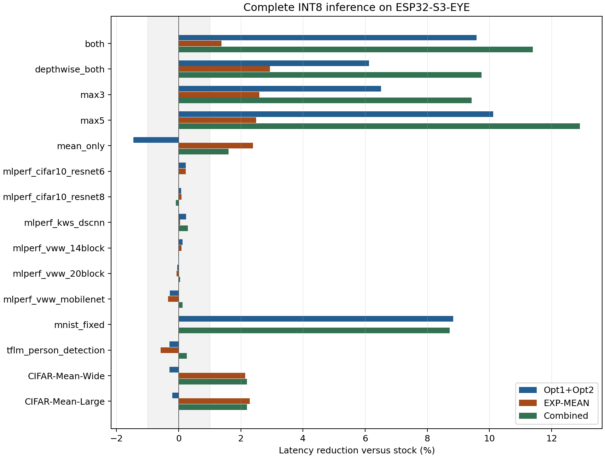
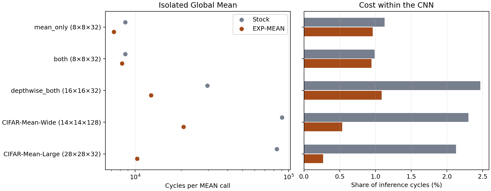

# ESP32-S3-EYE multi-model CNN benchmark and Global Mean follow-up

15 full CNNs passed with exact INT8 outputs across four firmware builds and 3,600 uninstrumented timed inferences. 5 executed EXP-MEAN QACC and 5 executed the Opt1+Opt2 sliding path. All models used their frozen inputs for performance runs.

- Best full-CNN comparison was 1.1483× on max5 with Combined. That graph did not call QACC.
- Best full-CNN EXP-MEAN comparison was 1.0302× on depthwise_both. Best isolated cycle speedup was 8.112× on CIFAR-Mean-Large.
- 60 additional inputs passed on all four builds. The study keeps these untimed checks separate from frozen-input measurements.
- Original evidence is preserved byte-for-byte. The frozen graph audit establishes that depthwise_both uses 16×16×32. mean_only and both use 8×8×32.

[Original 13-model report](../../results/CNN_RESULTS.md) · [Replay commands](../README.md)

## Full inference results

Each latency is in milliseconds. Each cell uses the median of the two boot medians from 30 samples per boot. The four variants used the same model and SDK settings. The baseline uses Espressif's optimized ESP32-S3 ESP-NN implementation. The two new INT8 graphs have no sliding pool.

| Model | Stock ms | Opt1+Opt2 ms / speedup | EXP-MEAN ms / speedup | Combined ms / speedup | Exact output |
|---|---:|---:|---:|---:|---|
| both | 3.6172 | 3.2705 / 1.1060× | 3.5675 / 1.0139× | 3.2050 / 1.1286× | PASS |
| depthwise_both | 4.9585 | 4.6545 / 1.0653× | 4.8130 / 1.0302× | 4.4750 / 1.1080× | PASS |
| max3 | 3.4680 | 3.2420 / 1.0697× | 3.3780 / 1.0266× | 3.1410 / 1.1041× | PASS |
| max5 | 3.6150 | 3.2490 / 1.1126× | 3.5250 / 1.0255× | 3.1480 / 1.1483× | PASS |
| mean_only | 3.1650 | 3.2110 / 0.9857× | 3.0892 / 1.0245× | 3.1140 / 1.0164× | PASS |
| mlperf_cifar10_resnet6 | 3464.9372 | 3457.0835 / 1.0023× | 3457.0315 / 1.0023× | 3464.8110 / 1.0000× | PASS |
| mlperf_cifar10_resnet8 | 347.6728 | 347.3850 / 1.0008× | 347.3690 / 1.0009× | 347.9680 / 0.9991× | PASS |
| mlperf_kws_dscnn | 17.4767 | 17.4340 / 1.0025× | 17.4695 / 1.0004× | 17.4250 / 1.0030× | PASS |
| mlperf_vww_14block | 170.9835 | 170.7750 / 1.0012× | 170.8228 / 1.0009× | 171.0060 / 0.9999× | PASS |
| mlperf_vww_20block | 254.1380 | 254.2520 / 0.9996× | 254.3010 / 0.9994× | 254.0325 / 1.0004× | PASS |
| mlperf_vww_mobilenet | 66.8423 | 67.0298 / 0.9972× | 67.0733 / 0.9966× | 66.7595 / 1.0012× | PASS |
| mnist_fixed | 3.0057 | 2.7400 / 1.0970× | 3.0060 / 0.9999× | 2.7435 / 1.0956× | PASS |
| tflm_person_detection | 59.0547 | 59.2278 / 0.9971× | 59.3993 / 0.9942× | 58.8970 / 1.0027× | PASS |
| CIFAR-Mean-Wide | 16.3890 | 16.4380 / 0.9970× | 16.0380 / 1.0219× | 16.0280 / 1.0225× | PASS |
| CIFAR-Mean-Large | 16.3465 | 16.3790 / 0.9980× | 15.9720 / 1.0234× | 15.9880 / 1.0224× | PASS |

| Model | Stock cycles | Opt1+Opt2 cycles | EXP-MEAN cycles | Combined cycles |
|---|---:|---:|---:|---:|
| both | 868,567.5 | 785,118 | 856,645 | 769,552 |
| depthwise_both | 1,191,016 | 1,117,466.5 | 1,155,706.5 | 1,074,496 |
| max3 | 832,500 | 778,335 | 811,051 | 754,216 |
| max5 | 867,864 | 779,982 | 846,442 | 755,863 |
| mean_only | 759,795 | 770,865 | 741,800.5 | 747,856 |
| mlperf_cifar10_resnet6 | 831,585,188.5 | 829,700,601 | 829,687,691.5 | 831,555,097.5 |
| mlperf_cifar10_resnet8 | 83,441,767 | 83,372,695 | 83,368,910.5 | 83,512,669 |
| mlperf_kws_dscnn | 4,194,923.5 | 4,184,545 | 4,193,137 | 4,182,335.5 |
| mlperf_vww_14block | 41,036,503 | 40,986,571 | 40,997,825.5 | 41,042,317 |
| mlperf_vww_20block | 60,993,602.5 | 61,020,826 | 61,032,646 | 60,968,435.5 |
| mlperf_vww_mobilenet | 16,042,550.5 | 16,087,553.5 | 16,098,080.5 | 16,022,714.5 |
| mnist_fixed | 721,569.5 | 657,698 | 721,569.5 | 658,673 |
| tflm_person_detection | 14,173,555 | 14,215,098.5 | 14,256,380.5 | 14,135,781.5 |
| CIFAR-Mean-Wide | 3,933,476.5 | 3,945,478 | 3,849,262 | 3,846,926 |
| CIFAR-Mean-Large | 3,923,427 | 3,931,179 | 3,833,473 | 3,837,262 |

### Regressions

- mean_only / Opt1+Opt2 took 1.453% longer than stock. The recorded verdict is CONTROL ONLY.

The CSV retains all observations, sample ranges and the original ±1% verdict rule. Inactive controls also show timing shifts. The isolated comparison measures the MEAN operation directly.

## Isolated Global Mean

The timer surrounds the same guarded ESP-NN MEAN call in each build, including reduction, requantization and output writes. Stock goes through its original ESP32-S3 backend. EXP-MEAN uses the pinned QACC backend. Routing, reference comparisons and diagnostic output stay outside these timed samples.

| CNN | MEAN NHWC shape¹ | Stock cycles | QACC cycles | Cycle speedup | Stock µs | QACC µs | Time reduction | Stock share² | QACC share² |
|---|---|---:|---:|---:|---:|---:|---:|---:|---:|
| mean_only | 8×8×32 | 8,628.00 | 7,258.50 | 1.189× | 36.00 | 30.00 | 16.67% | 1.13% | 0.96% |
| both | 8×8×32 | 8,628.00 | 8,220.00 | 1.050× | 36.00 | 34.00 | 5.56% | 0.99% | 0.95% |
| depthwise_both | 16×16×32 | 29,546.00 | 12,705.00 | 2.326× | 123.00 | 53.00 | 56.91% | 2.47% | 1.09% |
| CIFAR-Mean-Wide | 14×14×128 | 90,527.00 | 20,636.00 | 4.387× | 377.00 | 85.00 | 77.45% | 2.30% | 0.54% |
| CIFAR-Mean-Large | 28×28×32 | 83,509.00 | 10,294.00 | 8.112× | 348.00 | 43.00 | 87.64% | 2.13% | 0.27% |

¹ Batch size is 1. ² Adjusted operator cycles divided by median complete cycles with the nested timer disabled in the same binary.

| Model | Stock MEAN cycles | Opt1+Opt2 cycles / speedup | EXP-MEAN cycles / speedup | Combined cycles / speedup |
|---|---:|---:|---:|---:|
| mean_only | 8,628.00 | 8,628.00 / 1.000× | 7,258.50 / 1.189× | 8,928.00 / 0.966× |
| both | 8,628.00 | 9,009.00 / 0.958× | 8,220.00 / 1.050× | 9,030.00 / 0.955× |
| depthwise_both | 29,546.00 | 29,150.00 / 1.014× | 12,705.00 / 2.326× | 11,004.00 / 2.685× |
| CIFAR-Mean-Wide | 90,527.00 | 90,860.00 / 0.996× | 20,636.00 / 4.387× | 22,310.00 / 4.058× |
| CIFAR-Mean-Large | 83,509.00 | 83,509.00 / 1.000× | 10,294.00 / 8.112× | 12,766.00 / 6.542× |

- mean_only / Combined used 3.48% more isolated MEAN cycles than stock. Both boot medians were slower.

- both / Opt1+Opt2 used 4.42% more isolated MEAN cycles than stock. Both boot medians were slower. The MEAN kernel stayed on the stock implementation in this control.

- both / Combined used 4.66% more isolated MEAN cycles than stock. Both boot medians were slower.

### Measurement overhead and attribution

Each profiling boot interleaves 30 nested-timer samples with 30 calls in the same binary with the nested timer disabled. All paths restore the frozen input and validate every output outside the timed region. Raw operator samples and measurements of the empty region are retained. The operator table subtracts the per-boot median of the empty region. The microsecond clock has 1 µs resolution. Use cycle counts for the finer comparison.

The mean_only Opt1+Opt2 control had an original latency change of -1.453% and a +1.106% change with the profiling timer disabled in the profiling build. The graph has no MAX_POOL_2D. These firmware timing changes illustrate why the isolated operator comparison is needed.

| Model | Stock empty cycles | QACC empty cycles | Stock paired extra cycles | QACC paired extra cycles | QACC cycles saved | Outside-MEAN cycle change³ |
|---|---:|---:|---:|---:|---:|---:|
| mean_only | 394 | 394 | +413 | +2070 | +1369.5 | -8541 |
| both | 394 | 394 | +413.5 | +418 | +408 | -1108 |
| depthwise_both | 394 | 394 | +420 | +417 | +16841 | -13329 |
| CIFAR-Mean-Wide | 394 | 394 | +420 | +3349.5 | +69891 | -9777 |
| CIFAR-Mean-Large | 394 | 394 | +419 | +3175 | +73215 | -7026 |

³ Median cycles outside the raw nested region in the profiled EXP-MEAN build minus stock. These residuals include firmware layout, cache and scheduling effects. The uninstrumented full timings above are the primary end-to-end comparison.

## Correctness, dispatch and memory

| Model | Added inputs per build | On-board MEAN reference bytes compared | Output across builds | Arena and heap checks | Desktop reference matches |
|---|---:|---:|---|---|---:|
| mean_only | 12 | 18,432 | PASS | PASS | 12/12 |
| both | 12 | 18,432 | PASS | PASS | 12/12 |
| depthwise_both | 12 | 18,432 | PASS | PASS | 12/12 |
| CIFAR-Mean-Wide | 12 | 73,728 | PASS | PASS | 12/12 |
| CIFAR-Mean-Large | 12 | 18,432 | PASS | PASS | 12/12 |

Each untimed check compares the actual MEAN intermediate and five additional activation patterns against the pinned TFLite Micro reference and the originally registered MEAN. Kernel wrappers count actual QACC blocks and verify zero QACC calls in stock and Opt1+Opt2. The raw diagnostic logs include each case output, quantization, pointer alignment and dispatch.

| Model | Arena used | Stock image | Opt1+Opt2 image Δ | EXP-MEAN image Δ | Combined image Δ |
|---|---:|---:|---:|---:|---:|
| both | 29,884 B | 462,304 B | +656 B | +528 B | +1,216 B |
| depthwise_both | 18,060 B | 458,400 B | +608 B | +496 B | +1,344 B |
| max3 | 29,724 B | 481,024 B | +608 B | +496 B | +1,344 B |
| max5 | 29,724 B | 481,024 B | +608 B | +496 B | +1,344 B |
| mean_only | 29,660 B | 462,304 B | +656 B | +528 B | +1,216 B |
| mlperf_cifar10_resnet6 | 469,148 B | 1,247,712 B | +592 B | +0 B | +592 B |
| mlperf_cifar10_resnet8 | 206,844 B | 960,672 B | +544 B | -48 B | +704 B |
| mlperf_kws_dscnn | 35,516 B | 500,000 B | +544 B | -48 B | +720 B |
| mlperf_vww_14block | 196,412 B | 1,461,792 B | +544 B | -48 B | +704 B |
| mlperf_vww_20block | 202,476 B | 1,438,944 B | +544 B | -48 B | +704 B |
| mlperf_vww_mobilenet | 120,940 B | 806,512 B | +544 B | -48 B | +704 B |
| mnist_fixed | 28,396 B | 471,360 B | +544 B | -48 B | +704 B |
| tflm_person_detection | 120,988 B | 755,360 B | +544 B | -48 B | +704 B |
| CIFAR-Mean-Wide | 63,772 B | 478,384 B | +608 B | +496 B | +1,360 B |
| CIFAR-Mean-Large | 63,004 B | 462,304 B | +656 B | +528 B | +1,216 B |

All complete inference builds used the same 2 MiB PSRAM arena capacity. Arena usage matched across firmware variants for each model. Stack high-water marks and individual boot measurements are in the data.

## Evidence and scope

- The pinned IDF 5.5.1 and ESP-TFLite Micro 1.4.3 builds ran on the physical ESP32-S3-EYE at 240 MHz, with 8 MiB PSRAM. The two new classifiers share the original two-epoch CIFAR-10 training and INT8 calibration. Repeating training reproduced each FlatBuffer and its frozen input bytes.
- On CIFAR-10 test indices 0–999, the frozen INT8 classifiers achieved 23.3% for Wide and 21.8% for Large. They are small benchmark classifiers. The two MEAN shapes each reduce 25,088 INT8 values.
- The end-to-end evidence supports a targeted upstream kernel discussion. The stock TFLite Micro MEAN registration does not call ESP-NN. An upstream integration change would need maintainer review and validation on pretrained graphs that actually contain eligible MEAN. The two small Combined regressions also warrant measuring code layout and memory placement before enabling QACC broadly. The results cover fixed shapes, models and one board.

[Full CSV](analysis/compare.csv) · [MEAN CSV](analysis/mean_profile.csv) · [Individual full samples](analysis/full_samples.csv) · [Individual MEAN samples](analysis/mean_profile_samples.csv) · [Raw sample JSON](analysis/compare.json) · [Full runs](full/) · [Profiling runs](profile/) · [Diagnostics](diagnostics/) · [FlatBuffer audit](../models/mean_graphs.json)
